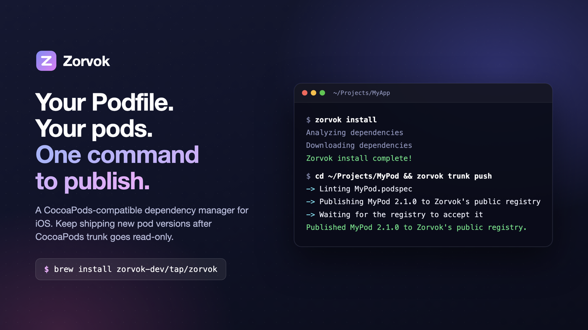
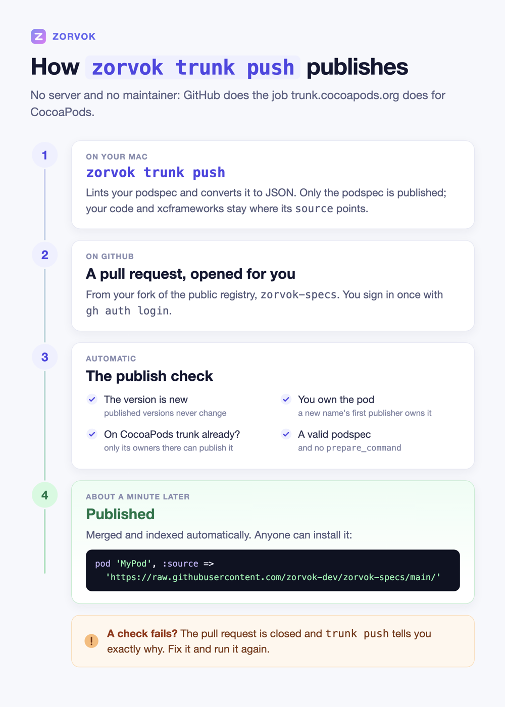

<p align="center">
  
</p>

# Zorvok: a CocoaPods-compatible dependency manager for iOS

**Keep your Podfile. Keep `pod install`'s results. Keep publishing pods after CocoaPods trunk goes read-only.**

Zorvok runs on top of CocoaPods instead of replacing it: `zorvok install` gives you the same `Pods/` folder and a byte-identical `Podfile.lock`. On top, it adds what CocoaPods doesn't have: one-command publishing to a free public registry, private registries without Podfile edits, and protection against dependency confusion.

[](https://github.com/zorvok-dev/homebrew-tap)
[](LICENSE)


```bash
brew install zorvok-dev/tap/zorvok
```

- [Why Zorvok](#why-zorvok)
- [Quick start](#quick-start)
- [Publish a pod](#publish-a-pod)
- [Install pods from Zorvok's registry or a private one](#install-pods-from-zorvoks-registry-or-a-private-one)
- [From `pod` to `zorvok`](#from-pod-to-zorvok)
- [FAQ](#faq)
- [How it works](#how-it-works)
- [Status and known gaps](#status-and-known-gaps)
- [Building from source](#building-from-source)

## Why Zorvok

**CocoaPods trunk becomes read-only on December 2, 2026.** The CocoaPods maintainers' [Trunk Read-only Plan](https://blog.cocoapods.org/CocoaPods-Specs-Repo/) keeps existing builds working, but trunk stops accepting new pods and new versions. If you maintain a pod, its next release has nowhere to go on trunk.

**Moving a large app to Swift Package Manager takes time.** Real apps depend on dozens of pods, internal frameworks and build scripts built around a Podfile.

**Mixing private and public pods has a sharp edge.** When two sources offer a pod with the same name, CocoaPods picks one by itself, at most printing a warning. That's the opening a dependency-confusion attack needs.

Zorvok keeps CocoaPods and fixes those three gaps:

- **Drop-in for `pod install` and `pod update`.** Same Podfile, same `Pods/`, byte-identical `Podfile.lock`. You can go back to `pod install` at any time.
- **One-command publishing.** `zorvok trunk push` publishes to [Zorvok's free public registry](https://github.com/zorvok-dev/zorvok-specs) like `pod trunk push` did to trunk, and the registry accepts it automatically, usually within a minute.
- **Existing pods stay with their owners.** A pod that exists on CocoaPods trunk can only be published on Zorvok by one of its owners there, checked automatically against trunk's own records.
- **Private and public pods together, safely.** Add a registry without editing your Podfile. If a pod could come from more than one source, Zorvok refuses to guess and asks you to pin it.
- **Every `pod` command.** `zorvok update`, `outdated`, `lib lint`, `spec`, `cache`, `deintegrate` and the rest map one-to-one; see [From `pod` to `zorvok`](#from-pod-to-zorvok).
- **Free and open source,** under the MIT license.

## Quick start

You need a Mac with Xcode and CocoaPods (`brew install cocoapods` or `gem install cocoapods`).

```bash
brew install zorvok-dev/tap/zorvok   # one command: adds the tap and trusts only this formula
zorvok doctor                        # checks Ruby, CocoaPods and git
cd ~/Projects/MyApp                  # any project with a Podfile
zorvok install
```

`zorvok install` runs `pod install` underneath and streams its output as usual. The last line is Zorvok's:

```text
Zorvok install complete! There are 12 dependencies from the Podfile and 31 total pods installed.
```

Open your `.xcworkspace` as usual. To update Zorvok itself later: `brew upgrade zorvok`.

## Publish a pod

Publishing works the way `pod trunk push` does. Only the podspec goes to the registry; your code, frameworks and xcframeworks stay wherever its `source` points, a git tag or a zip.

```bash
gh auth login                  # once: the public registry uses your GitHub account
cd ~/Projects/MyPod            # a folder with a single MyPod.podspec
zorvok trunk push
```

```text
-> Linting MyPod.podspec
-> Reading MyPod.podspec
-> Publishing MyPod 2.1.0 to Zorvok's public registry as your-github-username
-> Waiting for the registry to accept it (usually about a minute): https://github.com/zorvok-dev/zorvok-specs/pull/12
Published MyPod 2.1.0 to Zorvok's public registry. It can take up to 5 minutes to show up everywhere.
Use it with: pod 'MyPod', :source => 'https://raw.githubusercontent.com/zorvok-dev/zorvok-specs/main/'
```

<p align="center">
  
</p>

The public registry has no server, so GitHub does the job trunk.cocoapods.org does for CocoaPods. `trunk push` commits the podspec's JSON to your fork of the registry and opens a pull request. The registry's publish check then accepts or rejects it automatically, and nobody reviews anything by hand. It checks that:

- the version is new, since published versions never change;
- you own the pod (a new name's first publisher becomes its owner);
- if the name already exists on CocoaPods trunk, you're one of its owners there. That's usually matched through the email you registered with `pod trunk register`; if it can't match you, `trunk push` says exactly how to prove it;
- the podspec is valid and doesn't use `prepare_command`.

If a check fails, `trunk push` prints why and you run it again after fixing it. Without the GitHub CLI, set `GITHUB_TOKEN` instead of running `gh auth login`. The registry's own [README](https://github.com/zorvok-dev/zorvok-specs#publishing-a-package) covers the details, including adding co-owners.

## Install pods from Zorvok's registry or a private one

Pin a pod to Zorvok's registry with one line in your Podfile. This is standard CocoaPods syntax, so it works with both `zorvok install` and plain `pod install`:

```ruby
pod 'MyPod', '~> 2.1', :source => 'https://raw.githubusercontent.com/zorvok-dev/zorvok-specs/main/'
```

Or add the registry without touching your Podfile at all, with `--native`, which drives CocoaPods' own installer and adds the source in memory:

```bash
zorvok install --native --source https://raw.githubusercontent.com/zorvok-dev/zorvok-specs/main/

# or configure it once:
zorvok config set registry_url https://raw.githubusercontent.com/zorvok-dev/zorvok-specs/main/ --global
zorvok install --native
zorvok install --native --no-registry   # skip it for one run
```

The same works for a company spec repo or a self-hosted Zorvok registry server: use its URL instead. If your Podfile declares no `source` lines, Zorvok keeps the default CocoaPods CDN in play, so your public pods still resolve.

**No silent picks.** If a pod is found in more than one source and you haven't pinned it, Zorvok stops before installing anything:

```text
zorvok-native-install: refusing to install — the following pods resolve from more than one source and aren't pinned to one in the Podfile:
  NetworkKit: found in https://pods.example.com/, https://cdn.cocoapods.org/
Pin each one explicitly (e.g. `pod "Name", :source => "https://..."`, or `:path`/`:git` for a local or forked copy) to proceed.
```

Pinning it with `:source`, `:path` or `:git` resolves it; the pinned pod's own dependencies are still checked.

## From `pod` to `zorvok`

Every `pod` command has a `zorvok` equivalent. Those marked "runs `pod …`" call CocoaPods directly; `zorvok doctor` checks it's installed.

| CocoaPods | Zorvok | Notes |
|---|---|---|
| `pod install` | `zorvok install` | Runs `pod install`. Add `--native [--source <url>] [--no-registry]` for extra registries |
| `pod update [PODS]` | `zorvok update [PODS]` | Runs `pod update` |
| `pod outdated` | `zorvok outdated` | Runs `pod outdated` |
| `pod trunk push` | `zorvok trunk push [PODSPEC] [--allow-warnings] [--skip-lint]` | To Zorvok's public registry, or the registry server `registry_url` names |
| `pod trunk register` | `zorvok trunk register EMAIL [NAME]` / `zorvok login` | Registry servers only; the public registry uses `gh auth login` |
| `pod trunk me` / `add-owner` / `remove-owner` / `deprecate` / `info` | `zorvok trunk me` / `add-owner` / `remove-owner` / `deprecate` / `info` | Registry servers. On the public registry, owners are an `OWNERS` file |
| `pod trunk delete` | `zorvok trunk delete` | Explains why published versions can't be deleted, and points to `deprecate` |
| `pod search` | `zorvok search [QUERY]` / `zorvok info NAME` | Searches the configured registry server |
| `pod lib create` / `lib lint` | `zorvok lib create` / `lib lint` | Runs `pod lib …` |
| `pod spec …` | `zorvok spec cat\|create\|edit\|lint\|which` | Runs `pod spec …` |
| `pod repo add` / `add-cdn` / `list` / `remove` / `update` / `lint` / `push` | `zorvok registry add` / `add-cdn` / `list` / `remove` / `update` / `lint` / `push` | Runs `pod repo …` |
| `pod cache`, `ipc`, `plugins`, `list`, `try`, `env`, `setup`, `deintegrate` | Same name under `zorvok` | Runs the `pod` command of the same name |
| — | `zorvok init` | Creates a `.zorvok.yml` project config; never touches your Podfile, `Podfile.lock` or podspecs |
| — | `zorvok config [get KEY \| set KEY VALUE \| unset KEY] [--global]` | Settings such as `registry_url`. Project-local by default; `--global` writes your user config (`~/Library/Application Support/zorvok/config.yml` on macOS, or the folder `ZORVOK_CONFIG_DIR` names) |
| — | `zorvok doctor` | Checks Ruby, CocoaPods, git and Zorvok's own setup |

Run `zorvok --help` for the full list, or `zorvok <command> --help` for any command that runs `pod`.

## FAQ

**Is Zorvok a replacement for CocoaPods?**
No. Zorvok runs CocoaPods underneath: `zorvok install` calls the real `pod install`, so dependency resolution, `Podfile.lock` and Xcode integration are all CocoaPods' own code. Zorvok adds registries, publishing and safety checks on top.

**What happens to my app when CocoaPods trunk goes read-only?**
Your existing pods keep installing; the CocoaPods maintainers' plan keeps existing builds working. What stops on December 2, 2026 is publishing new pods and new versions to trunk. Zorvok gives those new versions a place to go.

**How do I keep publishing a pod that's already on CocoaPods trunk?**
Run `zorvok trunk push` in the pod's repository. Because the name exists on trunk, you need to be one of its owners there, and Zorvok checks that automatically. Your users then add `:source => 'https://raw.githubusercontent.com/zorvok-dev/zorvok-specs/main/'` to that pod's line in their Podfile.

**Do I have to change my Podfile?**
Not to use Zorvok. To get a pod from Zorvok's registry, either pin it with one `:source` on its line, or use `zorvok install --native` with the registry configured. A pod that exists in more than one source needs the pin, by design.

**Can I go back to `pod install`?**
Yes, at any time. Zorvok writes nothing CocoaPods doesn't understand; `.zorvok.yml`, if you create one, is ignored by `pod`.

**Does Zorvok work with Swift Package Manager?**
Zorvok manages your CocoaPods dependencies and doesn't migrate them. Swift packages you add in Xcode keep working alongside, exactly as they do with CocoaPods.

**What does publishing require?**
A GitHub account and a podspec whose `source` others can fetch (a git tag, or an HTTP zip for binary frameworks). There's no fee and no server to run.

**Where do I report a problem?**
[Open an issue](https://github.com/zorvok-dev/zorvok-ios/issues).

## How it works

Zorvok is a Go CLI. By default `zorvok install`, `update` and `lib lint` run the real `pod` binary, so Zorvok can't diverge from CocoaPods' behavior. The one deeper piece Zorvok owns is `zorvok install --native`, which drives CocoaPods' own `Pod::Installer` class directly. That's how it can add a registry that's declared nowhere in your Podfile, without ever writing to the file.

Zorvok can resolve pods from any mix of three kinds of registry, all speaking CocoaPods' CDN source protocol, so they're all reached the same way:

| | Registry | What it is |
|---|---|---|
| 1 | CocoaPods trunk, `cdn.cocoapods.org` | Unchanged; existing pods keep installing |
| 2 | [Zorvok's public registry](https://github.com/zorvok-dev/zorvok-specs) | Static files in a public GitHub repository: free, no server, publishing through `zorvok trunk push` |
| 3 | A self-hosted Zorvok registry server | For private or company-internal pods, with accounts, ownership and `zorvok trunk` commands |

Design details: [ARCHITECTURE.md](ARCHITECTURE.md) and the decision records in [docs/adr/](docs/adr/). [ADR 0010](docs/adr/0010-trunk-push-to-the-public-registry.md) covers publishing to the public registry.

## Status and known gaps

Zorvok is young; [ROADMAP.md](ROADMAP.md) has the full status.

- The public registry's publish workflow hasn't run on GitHub Actions yet. Its scripts are tested locally, and its script has run end to end against a local git repository with live CocoaPods trunk and GitHub data; the first real publish is the remaining check.
- Installing from the public registry while it has no pods yet occasionally fails with `Response: 501` from raw.githubusercontent.com. Running the command again works.
- The self-hosted registry server stores data in memory only and logs email verification links instead of sending them.
- On a registry server, a name belongs to its first publisher, with no reserved-name policy. The public registry additionally keeps names that exist on CocoaPods trunk with their trunk owners.

## Building from source

```bash
git clone https://github.com/zorvok-dev/zorvok-ios.git
cd zorvok-ios
go build -o zorvok ./cmd/zorvok
./zorvok --version
```

Or, without cloning: `go install github.com/zorvok-dev/zorvok-ios/cmd/zorvok@main`. Building needs the Go version in [go.mod](go.mod).

Run the tests with `go test ./...`. Tests that exercise real CocoaPods need `pod` and `git` on `PATH`, and the registry-server integration tests need a `zorvok-registry` binary; each skips rather than fails without them. If your terminal doesn't use a UTF-8 locale, set `LANG=en_US.UTF-8` first; CocoaPods requires it.

## Related repositories

- [zorvok-dev/zorvok-specs](https://github.com/zorvok-dev/zorvok-specs): Zorvok's free public pod registry
- [zorvok-dev/homebrew-tap](https://github.com/zorvok-dev/homebrew-tap): the Homebrew formula behind `brew install zorvok-dev/tap/zorvok`

Zorvok is iOS-only: no Android, Maven or Gradle support is planned. It isn't open to outside code contributions yet, but issues and discussion are welcome.

## License

MIT; see [LICENSE](LICENSE). Zorvok is an independent project and isn't affiliated with or endorsed by CocoaPods.
